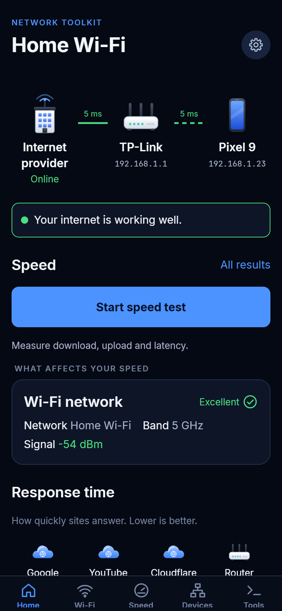
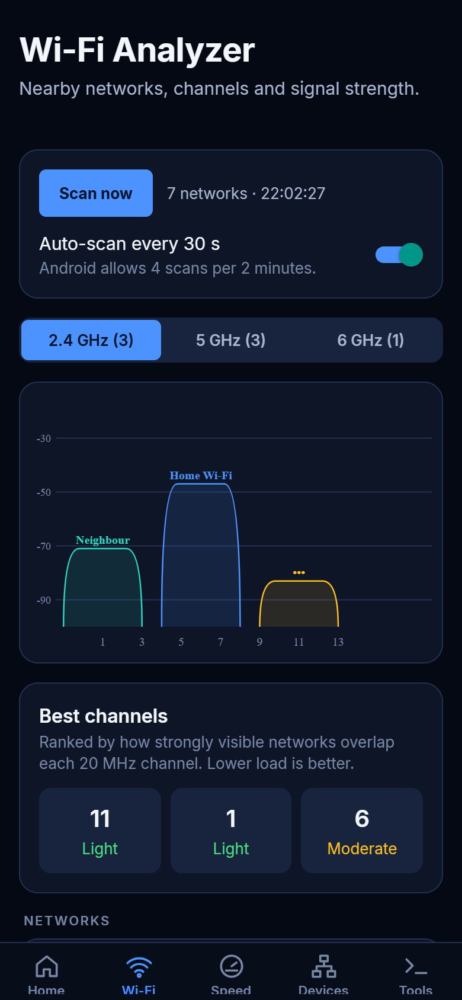
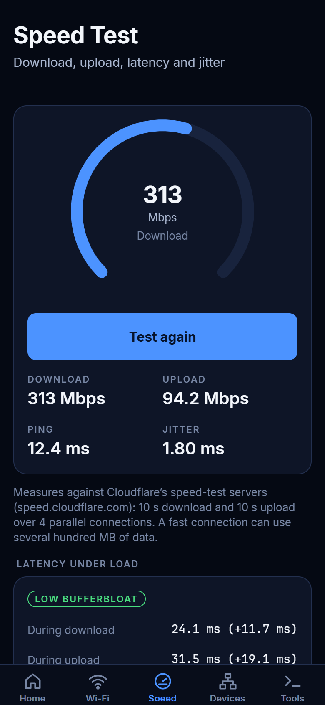
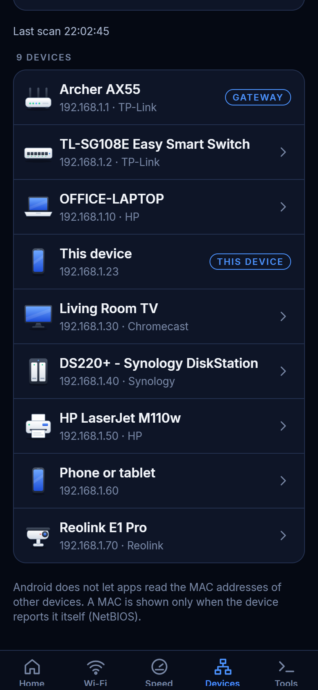
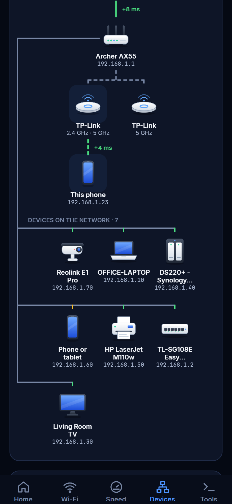
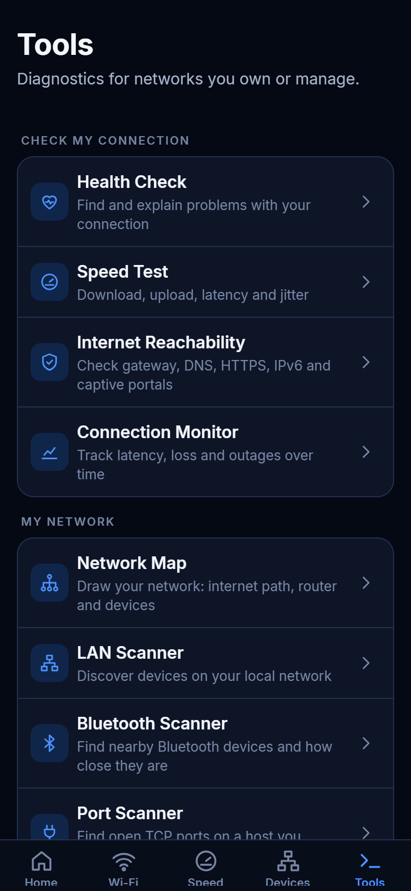
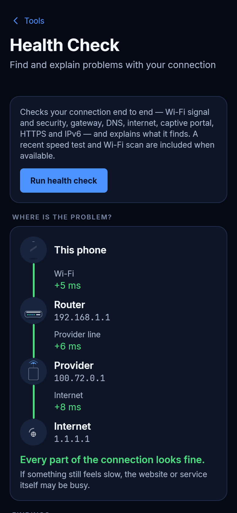

<div align="center">


# Network Toolkit

**An open source network diagnostics toolkit for Android** — Wi-Fi analysis,
internet diagnostics, LAN discovery and network administration tools in one
native app.

[](https://github.com/Krumqnkata/network-toolkit/actions/workflows/ci.yml)
[](https://github.com/Krumqnkata/network-toolkit/actions/workflows/codeql.yml)
[](LICENSE)


</div>

<!-- prettier-ignore -->
> [!NOTE]
> **Status: 1.1 — stable.** All nine milestones are implemented: home screen,
> Wi-Fi Analyzer, network tools, LAN and Bluetooth scanners, speed test,
> connection monitor and health check. Installed copies update themselves from
> the [Releases](https://github.com/Krumqnkata/network-toolkit/releases) page —
> see the [roadmap](#roadmap) for what comes next.

## Features

Planned feature modules. The **Status** column reflects what is actually
implemented in the current code.

| Module                   | Highlights                                                                                     | Status    |
| ------------------------ | ---------------------------------------------------------------------------------------------- | --------- |
| **Dashboard**            | Connection type, IP, gateway, DNS, Wi-Fi signal, internet reachability, quick access to tools  | Available |
| **Wi-Fi Analyzer**       | 2.4 / 5 / 6 GHz scans, channels, overlap analysis, signal history, Wi-Fi by room               | Available |
| **Network Tools**        | Ping, traceroute, DNS & reverse DNS, reachability, HTTP headers, TLS certificates, IP info     | Available |
| **LAN Scanner**          | Device discovery and identification, network map, port scanner, security check                 | Available |
| **Internet Diagnostics** | Speed test with bufferbloat and packet loss; provider report with automatic tests              | Available |
| **Advanced Diagnostics** | Connection monitoring, outage tracking, "where is the problem?" per-segment diagnosis, reports | Available |
| **Network Map**          | Self-building topology: path to the internet, router, mesh access points, LAN and Bluetooth    | Available |

Design principles:

- **Native and honest.** Built on official Android APIs and their real
  limits — scan throttling, MAC randomization, permission requirements — and
  never shows data the OS does not actually provide.
- **Local first.** Diagnostics run on the phone; no account, no cloud service.
- **English and Bulgarian.** The whole interface is available in both
  languages and follows the device language by default.
- **Permissions in context.** Nothing is requested on first launch; each
  permission is requested when the feature that needs it is used
  ([details](docs/PERMISSIONS.md)).
- **Private by design.** No accounts, ads or analytics; history stays on the
  device ([privacy](docs/PRIVACY.md)).
- **For networks you manage.** Scanning tools are intended for networks you
  own or are authorized to test.

## Screenshots

|                                                         Home                                                          |                                               Wi-Fi Analyzer                                                |                                    Speed test                                     |
| :-------------------------------------------------------------------------------------------------------------------: | :---------------------------------------------------------------------------------------------------------: | :-------------------------------------------------------------------------------: |
|        |             |      |
|                                                      **Devices**                                                      |                                               **Network map**                                               |                                     **Tools**                                     |
|  |  |  |
|                                               **Where is the problem?**                                               |                                                                                                             |                                                                                   |
|          |                                                                                                             |                                                                                   |

> These images are rendered from the app's own UI code with sample data (a
> web build of the screens, not captures from a phone), so fonts and spacing
> may differ slightly from Android. The devices, names and addresses shown are
> examples.

## Tech stack

| Area       | Technology                                                         |
| ---------- | ------------------------------------------------------------------ |
| UI         | React Native 0.88 (New Architecture, Hermes), TypeScript (strict)  |
| Navigation | React Navigation 7 (native stack + bottom tabs)                    |
| State      | Zustand                                                            |
| Native     | Kotlin, Android SDK, Turbo Native Modules                          |
| Graphics   | react-native-svg (icons, channel graph, sparklines)                |
| Storage    | SQLite (Android built-in, via a Kotlin Turbo Native Module)        |
| Testing    | Jest, React Native Testing Library, JUnit; Maestro planned for E2E |
| Quality    | ESLint, Prettier, CodeQL, Dependabot, dependency review            |
| CI/CD      | GitHub Actions — checks on every PR, signed releases from Git tags |

## Installation

Signed APKs are published on the
[Releases](https://github.com/Krumqnkata/network-toolkit/releases) page:

1. Download the APK for your phone from the latest release —
   `NetworkToolkit-vX.Y.Z-arm64-v8a.apk` for almost every current phone, or the
   universal `NetworkToolkit-vX.Y.Z.apk` if unsure — and `checksums.txt`.
2. Optionally verify the download: `sha256sum -c checksums.txt`.
3. Open the APK on your phone and allow installation from that source when
   Android asks.

Requires Android 8.0 (API 26) or newer.

## Building from source

Prerequisites: Node.js 24 LTS, JDK 17, Android SDK (platform 37, build-tools
37.0.0, NDK 27.1.12297006) — see the
[React Native environment setup](https://reactnative.dev/docs/set-up-your-environment).

```sh
git clone https://github.com/Krumqnkata/network-toolkit.git
cd network-toolkit
npm ci
npm start           # Metro bundler, in one terminal
npm run android     # build + install the debug app, in another
```

Run the checks that CI runs:

```sh
npm run verify                                   # types, lint, format, Jest
cd android && ./gradlew testDebugUnitTest assembleDebug
```

Release builds and signing are described in [docs/RELEASING.md](docs/RELEASING.md).

## Architecture

The app is split into presentation, application, domain and infrastructure
layers. Screens never talk to Android directly: all native work goes through
typed Turbo Native Modules written in Kotlin, which run off the UI thread.
Each feature lives in its own folder under `src/features` and can be developed
and tested independently.

Read more in [docs/ARCHITECTURE.md](docs/ARCHITECTURE.md).

## Roadmap

| #   | Milestone           | Scope                                                          | Status |
| --- | ------------------- | -------------------------------------------------------------- | ------ |
| 1   | Foundation          | Project setup, architecture, navigation, theme, CI/CD          | Done   |
| 2   | Native bridge       | Turbo Native Module infrastructure, typed and validated bridge | Done   |
| 3   | Network information | Connection, IP, gateway, DNS, Wi-Fi signal on the dashboard    | Done   |
| 4   | Wi-Fi Analyzer      | Scanning, channels, RSSI, charts, overlap analysis             | Done   |
| 5   | Network diagnostics | Ping, DNS lookup, traceroute, HTTP and TLS tools               | Done   |
| 6   | LAN Scanner         | Device discovery, device identification, port scanning         | Done   |
| 7   | Speed test          | Download, upload, latency, jitter, packet loss                 | Done   |
| 8   | Advanced features   | History, monitoring, automatic diagnostics, reports            | Done   |
| 9   | Optimization        | Performance, battery, compatibility, 1.0 release               | Done   |

The first public version (MVP) covers milestones 1–5: dashboard, network
information, Wi-Fi Analyzer, ping and DNS lookup.

After 1.0: per-segment diagnosis, the network map and smarter device
identification are done. MikroTik RouterOS integration remains an idea.

## Changelog

See [CHANGELOG.md](CHANGELOG.md).

## Contributing

Contributions are welcome — please read [CONTRIBUTING.md](CONTRIBUTING.md) and
the [Code of Conduct](CODE_OF_CONDUCT.md). Security issues should be reported
privately as described in [SECURITY.md](SECURITY.md).

## License

Network Toolkit is free software, licensed under the
[GNU Affero General Public License v3.0 only](LICENSE) (`AGPL-3.0-only`).

Bundled fonts (Inter, JetBrains Mono) and data are listed in
[THIRD_PARTY_NOTICES.md](THIRD_PARTY_NOTICES.md).
